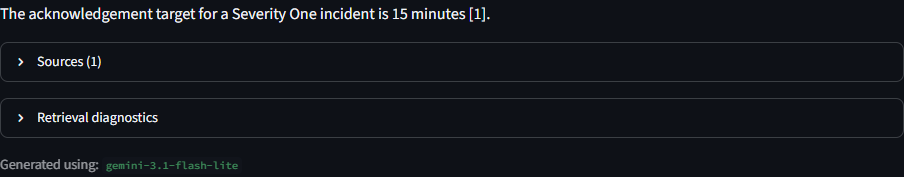
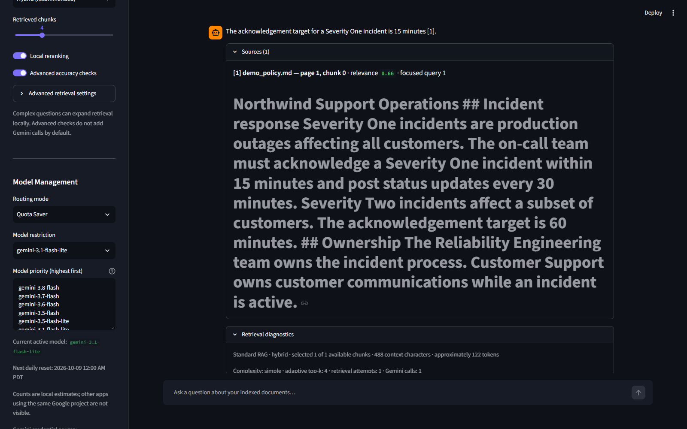
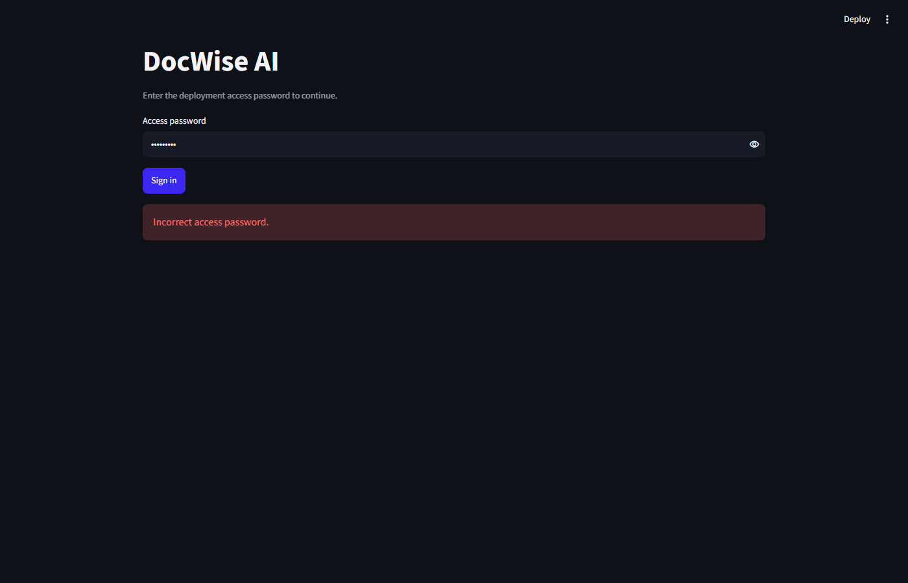
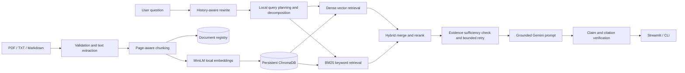

# DocWise AI

**Intelligent Document RAG System** is a production-style portfolio project for asking grounded questions across PDF, TXT, and Markdown files. It combines local Sentence Transformer embeddings, persistent ChromaDB storage, hybrid retrieval, and Google Gemini generation in a Streamlit chat experience.

The project solves a common enterprise AI problem: finding precise information in private document collections while showing the evidence behind every answer and declining questions the collection cannot support.

It is designed as a recruiter-reviewable reference implementation: the retrieval, routing,
verification, evaluation, security boundaries, and known limitations are visible in the code and
UI rather than hidden behind a hosted API.

## Highlights

- Multi-document PDF, TXT, and Markdown ingestion
- Page-level metadata, configurable chunking, and deterministic vector IDs
- SHA-256 duplicate prevention and a persistent document registry
- Document listing, deletion, and reindexing from both UI and CLI
- Local `all-MiniLM-L6-v2` embeddings and persistent ChromaDB
- Dense vector, BM25 keyword, and weighted hybrid retrieval
- Optional local relevance reranking and visible similarity scores
- Conversational follow-up rewriting using Gemini
- Free-tier-only Gemini routing with SQLite usage estimates and visible fallback reasons
- Strict grounding prompt, invalid-citation filtering, and insufficient-evidence response
- Local query decomposition, adaptive retrieval depth, and one bounded self-correction attempt
- Deterministic claim-to-citation verification with unsupported/contradictory claim suppression
- Source filename, page, score, and expandable evidence snippets
- Recall@K and MRR evaluation, plus a clearly separate optional LLM judge
- Automated tests with real Chroma persistence, end-to-end local workflows, and bounded mocked model calls
- Environment-based secrets, upload validation, retry/timeout controls, and Docker support

## Verified interface

The screenshots below were captured by the repository's Playwright browser test against an
isolated synthetic document. They are application output, not mockups.







## Architecture



Documents are treated as untrusted evidence. Instructions embedded inside uploaded files are not granted control over the assistant.

## Technology

- Python 3.12
- LangChain 1.x
- Google Gemini through an explicit free-tier allowlist and automatic router
- Hugging Face Sentence Transformers (`all-MiniLM-L6-v2`)
- ChromaDB persistent local storage
- PyPDF
- Streamlit
- Pytest

## Project structure

```text
rag-system/
├── app.py                         # Streamlit application
├── ingest.py                      # Document-management CLI
├── chat.py                        # Conversational RAG CLI
├── evaluate.py                    # Retrieval evaluation CLI
├── docwise/
│   ├── config.py                  # Environment configuration
│   ├── document_loader.py         # Validation and extraction
│   ├── chunking.py                # Chunk generation
│   ├── embeddings.py              # Local embedding factory
│   ├── vector_store.py            # Chroma and document lifecycle
│   ├── retrieval.py               # Vector, BM25, hybrid, reranking
│   ├── rag.py                     # Rewriting, grounding, Gemini
│   ├── model_router.py            # Free-tier routing and SQLite quota estimates
│   ├── history.py                 # Conversation history
│   ├── evaluation.py              # Recall@K, MRR, optional judge
│   ├── models.py                  # Shared typed models
│   └── exceptions.py              # User-safe domain errors
├── evaluation/example_questions.json
├── tests/
├── .streamlit/config.toml
├── Dockerfile
└── requirements.txt
```

Runtime documents, the registry, and the Chroma index are stored under `.docwise/` and intentionally excluded from Git.

## Windows PowerShell setup

From the project folder:

```powershell
py -3.12 -m venv .venv
.\.venv\Scripts\Activate.ps1
python -m pip install --upgrade pip
python -m pip install -r requirements-dev.txt
Copy-Item .env.example .env
```

Edit `.env` and set your Gemini key:

```dotenv
GOOGLE_API_KEY=your_real_key_here
GEMINI_ROUTING_MODE=balanced
```

`GOOGLE_API_KEY` is the canonical name. `GEMINI_API_KEY` is accepted as a compatibility alias
when the canonical variable is absent. If both are configured, DocWise explicitly passes
`GOOGLE_API_KEY` to the client and leaves both environment values unchanged; the sidebar shows
the selected variable name but never its value.

The first launch downloads the embedding model from Hugging Face. Later runs use the local cache. Never commit `.env`.

## Gemini free-tier routing

DocWise only routes to models explicitly listed in `config/gemini_models.json` and hard-coded in its free-tier safety allowlist. An environment variable cannot introduce an unknown or paid model. The configured default priority is:

```text
gemini-3.8-flash
gemini-3.7-flash
gemini-3.6-flash
gemini-3.5-flash
gemini-3.5-flash-lite
gemini-3.1-flash-lite
```

The RPM, TPM, and RPD values in that file are local safety limits based on the supplied AI Studio dashboard—not promises of Google-side availability. DocWise counts attempts conservatively against its estimated daily allowance. Other applications using the same Google project can consume quota that DocWise cannot see.

Routing modes:

| Mode | Simple questions and rewrites | Comparisons and difficult reasoning |
|---|---|---|
| Balanced | Lite first, then approved Flash fallback | Strongest available Flash first |
| Quality First | Strongest approved model first | Strongest approved model first |
| Quota Saver | Lite only | Strong Flash reserved for genuinely complex work |

Choosing **Lite models only**, or manually choosing a Lite model, prevents fallback to a stronger model. Daily quota exhaustion advances to the next eligible model. Temporary RPM/TPM errors retry the same model with bounded exponential backoff before fallback. Ambiguous HTTP 429 responses are treated as temporary, not automatically classified as daily exhaustion.

Usage is stored in `.docwise/gemini_usage.sqlite3` using SQLite WAL transactions. Quota dates and reset estimates use midnight in `America/Los_Angeles`, including daylight-saving changes. Streamlit displays local attempts, remaining estimated requests, cooldowns, the last fallback reason, and the next reset time.

## Run the web application

```powershell
.\.venv\Scripts\Activate.ps1
streamlit run app.py --server.address=127.0.0.1
```

Open the local URL shown by Streamlit. Upload one or more documents in the sidebar, choose chunk settings, select **Index uploaded documents**, and then ask questions in the main chat.

## Run from the terminal

Place files in `data/`, then index all supported files:

```powershell
python ingest.py
python chat.py
```

Other document-management commands:

```powershell
python ingest.py .\data\handbook.pdf .\data\notes.md
python ingest.py --list
python ingest.py --reindex DOCUMENT_ID --chunk-size 800 --chunk-overlap 120
python ingest.py --delete DOCUMENT_ID
python chat.py --strategy hybrid --top-k 6
```

`python ingest.py --force` recreates vectors for files whose content hash is already registered. A changed file receives a new content-derived document ID.

## Retrieval modes

| Mode | Behavior | Best use |
|---|---|---|
| `vector` | Semantic cosine similarity | Paraphrases and conceptual questions |
| `keyword` | In-process BM25 scoring | Exact names, identifiers, and terminology |
| `hybrid` | Weighted vector + BM25 scores | General use; the default |

Reranking adds a small query-term coverage signal to the candidate score. It is local, deterministic, and does not require another paid model. The baseline-versus-improved evaluation compares plain vector retrieval against hybrid retrieval with reranking.

### Intelligent and self-correcting retrieval

When advanced accuracy checks are enabled, DocWise classifies the question locally. Simple questions keep one query and the configured top-k. Multi-part questions are split into at most four focused queries and receive a bounded adaptive top-k. Retrieved chunks are deduplicated and constrained by both character and estimated-token budgets.

If local relevance and sub-question coverage checks fail, DocWise reformulates the missing facets deterministically and performs exactly one additional retrieval attempt. It does not make an extra Gemini call for decomposition, sufficiency checking, reformulation, or answer verification. If the retry remains insufficient, the answer declines or explicitly states the evidence limitation.

After generation, factual lines are checked against their cited chunks. Invalid citation labels, unrelated claims, and clear polarity contradictions are recorded in diagnostics; unsupported generated claims are omitted from the delivered answer. Conversation history remains navigation-only and is never included in the evidence verifier.

### Resume and job-description comparisons

Comparison-style questions automatically use document-aware retrieval instead of the normal global top-k limit. DocWise includes every chunk from short documents (up to eight chunks per document), applies per-document quotas to longer files, and then fills remaining capacity by relevance. The retrieval diagnostics panel shows the filename, page, chunk, score, selection reason, per-document counts, and whether the context budget omitted anything.

The comparison workflow separately reports required skills, demonstrated skills, employment history, calculated experience duration, relevant projects, and requirements not documented in the resume. Employment month ranges are parsed and totaled in Python, with overlapping periods counted once. Absence from a resume is described as **not documented**, not as proof that the candidate lacks the skill.

## Example interaction

After indexing an employee handbook:

```text
Question: How much annual leave do full-time employees receive?

Answer: Full-time employees receive 20 days of annual leave per year [1].

[1] employee-handbook.pdf — page 14
```

If retrieved evidence is absent or below the configured threshold, DocWise responds:

```text
I couldn't find that information in the indexed documents.
```

## Configuration

| Variable | Default | Purpose |
|---|---:|---|
| `GOOGLE_API_KEY` | none | Canonical Gemini credential variable |
| `GEMINI_API_KEY` | none | Compatibility alias used only when the canonical variable is absent |
| `GEMINI_ROUTING_MODE` | `balanced` | `balanced`, `quality_first`, or `quota_saver` |
| `GEMINI_MODEL_CONFIG` | `config/gemini_models.json` | Free-tier model limits and priority |
| `GEMINI_USAGE_DB` | `.docwise/gemini_usage.sqlite3` | Persistent local quota estimates |
| `EMBEDDING_MODEL` | `sentence-transformers/all-MiniLM-L6-v2` | Local embedding model |
| `RETRIEVAL_STRATEGY` | `hybrid` | `vector`, `keyword`, or `hybrid` |
| `TOP_K` | `4` | Chunks supplied as evidence |
| `CHUNK_SIZE` | `1000` | Chunk size in characters |
| `CHUNK_OVERLAP` | `200` | Overlap in characters |
| `MIN_RELEVANCE_SCORE` | `0.15` | Insufficient-context threshold |
| `ADVANCED_RAG` | `true` | Enable intelligent planning, retrieval, and verification |
| `QUERY_DECOMPOSITION` | `true` | Split multi-requirement questions locally |
| `ADAPTIVE_RETRIEVAL` | `true` | Increase top-k for complex questions |
| `SELF_CORRECTING_RAG` | `true` | Allow one bounded retrieval retry |
| `ANSWER_VERIFICATION` | `true` | Check generated claims against cited chunks |
| `MAX_SUBQUERIES` | `4` | Maximum focused retrieval queries |
| `MAX_ADAPTIVE_TOP_K` | `10` | Maximum standard-RAG adaptive depth |
| `MAX_CONTEXT_CHARACTERS` | `60000` | Hard context character budget |
| `MAX_CONTEXT_TOKENS` | `15000` | Approximate hard context token budget |
| `MAX_FILE_SIZE_MB` | `25` | Per-file upload limit |
| `GEMINI_TIMEOUT_SECONDS` | `60` | API request timeout |
| `GEMINI_MAX_RETRIES` | `2` | Transient request retries |
| `DOCWISE_STORAGE_DIR` | `.docwise` | Documents, registry, and Chroma location |

## Evaluation

The repository includes a small labeled sample. Index it and run the comparison:

```powershell
python ingest.py .\evaluation\sample_employee_policy.md
python evaluate.py --dataset .\evaluation\example_questions.json --top-k 4
python evaluate.py --dataset .\evaluation\cv_jd_regression.json --top-k 4
python evaluate.py `
  --dataset .\evaluation\docwise_benchmark_40.json `
  --corpus-dir .\evaluation\benchmark_corpus `
  --top-k 2 --chunk-size 350 --chunk-overlap 60
```

For a meaningful project evaluation, replace or extend those labels with questions from your own showcase documents.

The report compares fixed-depth vector baseline RAG against decomposed, adaptive hybrid RAG and includes:

- **Recall@K**: fraction of expected source documents retrieved in the top K.
- **Mean Reciprocal Rank**: rewards placing the first relevant source near the top.
- **Per-question results**: expected sources, retrieved sources, and individual scores.

These are automatic retrieval metrics. `llm_grade_answer` is an optional subjective assessment of groundedness and completeness and is intentionally reported separately from deterministic metrics.

The comprehensive benchmark contains 41 manually labeled questions over 10 synthetic documents. It reports baseline vector, BM25, hybrid, hybrid-reranked, and intelligent adaptive retrieval using the same isolated corpus. See [measured benchmark results](evaluation/BENCHMARK_RESULTS.md). The current top-k 2 run improved recall from 0.86 for hybrid reranking to 0.88 for intelligent retrieval, with unchanged precision/MRR and a small latency cost. At top-k 4, retrieval quality was tied. These measured results intentionally do not claim a universal improvement.

## Tests

Automated tests mock external Gemini calls. Vector lifecycle tests use a small deterministic embedding implementation with a real temporary Chroma database. The 2026-10-09 audit additionally completed bounded live Lite-model smoke calls using synthetic, non-sensitive input; see [AUDIT_REPORT.md](AUDIT_REPORT.md).

The suite also covers full local file-to-answer flow, duplicate indexing, deletion/reindexing, long-document retrieval, all retrieval strategies, multi-document comparison, conversational follow-ups, prompt injection, verifier uncertainty, incorrect citations, contradictions, context budgets, self-correction, quota fallback, usage persistence, and access/rate-limit controls.

```powershell
python -m pytest
```

The Playwright suite is opt-in because it starts a local Streamlit server, opens Chrome or Edge,
and makes one live Gemini request:

```powershell
$env:RUN_BROWSER_TESTS='1'
python -m pytest -m browser tests\browser\test_streamlit_ui.py
```

It uses only `tests/fixtures/demo_policy.md` and an isolated temporary storage directory. Set
`PLAYWRIGHT_BROWSER_EXECUTABLE` when Chrome or Edge is not in a standard Windows location.

Run only the routing and fallback tests:

```powershell
python -m pytest tests\test_model_router.py -v
```

These tests simulate daily exhaustion, RPM/TPM limits, fallback, concurrent requests, Pacific-time resets, unexpected errors, and forbidden paid-model configuration without making live API requests. To exercise a fallback manually, copy `config/gemini_models.json`, lower the first model's `rpd` in the copy, set `GEMINI_MODEL_CONFIG` to that copy, and use **Quality First** mode. Restore the normal configuration afterward.

## Docker and deployment

Build and run locally:

```powershell
docker build -t docwise-ai .
docker run --rm -p 8501:8501 `
  -e GOOGLE_API_KEY=$env:GOOGLE_API_KEY `
  -v "${PWD}\docwise-storage:/app/storage" `
  docwise-ai
```

For Streamlit Community Cloud, configure `GOOGLE_API_KEY` in the app's secret settings. Free app hosts often use ephemeral filesystems, so indexed documents may disappear after a restart. For a durable deployment, mount a persistent volume at the directory named by `DOCWISE_STORAGE_DIR`, or move the vector store and document registry to managed durable services. See [DEPLOYMENT.md](DEPLOYMENT.md) for the reviewed portfolio-demo options and checklist.

For any internet-accessible deployment, set a long random `DOCWISE_ACCESS_PASSWORD` and an appropriate `DOCWISE_QUERY_RPM`. The built-in limiter is per Streamlit session and is only a first line of defense; production deployments should additionally use identity-aware access control and a reverse-proxy or gateway rate limit. Run locally with `--server.address=127.0.0.1` when network access is not needed.

The Docker image runs as the unprivileged `docwise` user. Uploaded documents, Chroma data, the registry, and quota-tracking SQLite database belong under the mounted `/app/storage` volume.

## Troubleshooting

- **Embedding download fails:** connect once so Hugging Face can cache the model, or set `HF_HUB_OFFLINE=1` and `TRANSFORMERS_OFFLINE=1` after it is cached.
- **Gemini cannot connect:** verify outbound DNS/HTTPS access and that `GOOGLE_API_KEY` or its `GEMINI_API_KEY` compatibility alias is configured. If both exist, DocWise deliberately uses `GOOGLE_API_KEY`. Never print either value.
- **No eligible Gemini model:** inspect the free-tier usage estimates and cooldowns in the sidebar. Local quota values are safety estimates, not Google guarantees.
- **Scanned PDF has no text:** OCR is not bundled; convert it to a searchable PDF before indexing.
- **Comparison misses a file:** inspect document-routing diagnostics and raise context/document limits only when the relevant file is genuinely omitted.
- **Verifier marks a paraphrase uncertain:** inspect its cited excerpt. Uncertain cited paraphrases are preserved rather than automatically deleted.

## Reliability and security decisions

- Upload extensions, size, emptiness, corruption, and extractable PDF text are validated.
- Scanned PDFs fail with an explicit OCR-needed message; they are never reported as successfully indexed.
- Uploaded names are reduced to safe basenames and managed copies are content-addressed.
- API keys are selected deterministically, passed explicitly to the Gemini client, and never logged.
- Gemini calls use an approved-model allowlist, timeouts, bounded rate-limit retries, and visible fallback reasons.
- Generated inline citation numbers are checked against the retrieved evidence set.
- Deletes target exact vector IDs and only remove managed document copies.

## Current limitations

- OCR is not bundled; image-only PDFs require a future OCR pipeline.
- BM25 currently scans locally stored chunks, which is appropriate for a portfolio-scale collection but not millions of chunks.
- The JSON registry is designed for a single application instance. Multi-instance deployment should use a transactional database.
- Retrieval scores are useful ranking signals, not calibrated probabilities.
- Lexically uncertain cited paraphrases are preserved and flagged, which avoids destructive false negatives but means a human should review high-stakes answers.
- The bundled CV/JD retrieval benchmark is a small regression set, not a statistically representative production evaluation.
- The built-in password and per-session rate limiter do not replace organization-level authentication, authorization, audit logging, or gateway rate limiting.
- LLM-based answer grading can itself be biased and should not replace human review.
- Local quota counts are estimates and cannot see usage from other applications or authoritative Google-side quota changes.

## Good next extensions

- Add OCR with Tesseract or a document-intelligence service.
- Add metadata filters, collections, and user-level authorization.
- Introduce a cross-encoder reranker for larger corpora.
- Add tracing and a curated regression evaluation set.
- Move storage to a managed vector database for horizontal deployment.
